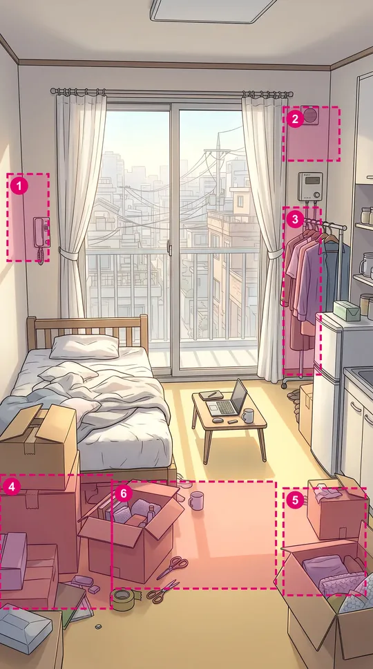

# Phase 4 自宅の家具：一覧の案と、部屋の6か所の決まり

教材担当への資料です（Claude Code が作成。2026-11-25）。

**2026-11-25 確定**：一覧の21点・6か所の決まりは、この案のとおりで確定しました（家具18の名前だけ変更）。Q1 は A です。引っ越しを終える（第1章のお隣さんへのあいさつ event_001 を終える）までは、自宅を今の絵（`home_moving`）にし、そのあと（先生とのふり返り event_006 から）は新しい部屋の絵＋家具にします。データは `src/data/furniture/furniture.json`・`src/data/game/balance.json` の `room` です（docs/CONTENT_FORMAT.md 29章）。Phase 4 区切り3（自宅の家具の配置）の前に、次の2つを決めるために使います。

1. 家具・小物の一覧（日本語の名前・置く場所・値段・買えるレベル・節目専用か）。**案です。教材担当が確認し、直してください。**
2. 部屋の6か所の、絵の中の位置・大きさ（縦横の比）・向き・家具の絵の背景の決まり。部屋の絵・家具の絵の指示文（docs/ART_GUIDE.md）を書くときに使ってください。

家具の韓国語の名前（単語）と、絵の指示文は教材担当が書きます（Phase 4 計画 Q6・Q7）。

---

## 1. 家具・小物の一覧（案）

- 置く場所の番号は、2章の6か所です。1か所に置けるのは1つだけです。
- 値段はコイン、レベルは「その家具がカタログで買えるようになるレベル」です。
  - コインとレベルの数値は、Phase 4 区切り2 で決めます（第3章を終えるころに Lv5 前後、コインは合わせて 800〜1,000 枚ほどの見込み）。そのため、下の値段とレベルは、数値が決まったあとで少し動くことがあります。
  - 第3章までで、Lv5 までの家具の半分くらいが買える、という釣り合いを目安にしています。Lv6 以上は、第4章以降のためのものです。
- 「節目専用」の家具は、カタログでは売らず、スタンプの節目（集めた合計の日数）でだけもらえます。
- どの家具にも、絵の中に文字（韓国語・日本語・数字）を描きません（GAME_SPEC 8-3）。
- 韓国語の名前は、教材担当が単語として用意します（任意。用意した家具だけ、押すと意味が出て「覚える」で見かけた単語に入ります）。

| ID | 日本語の名前 | 置く場所 | 値段 | レベル | 節目専用 | メモ |
|---|---|---|---|---|---|---|
| furniture_001 | 壁かけ時計 | 1 壁（左） | 80 | 1 | | 文字盤に数字を描かない（点や線だけ） |
| furniture_002 | ソウルの夜景のポスター | 1 壁（左） | 100 | 2 | | 文字なし。南山タワーなど、特定の会社のロゴがないもの |
| furniture_003 | 写真をはったコルクボード | 1 壁（左） | 150 | 4 | | 写真の中の人の顔は小さく、はっきり描かない |
| furniture_004 | 小さな飾り棚 | 2 壁（右） | 120 | 2 | | 小物（小さな植物・マグカップ）がのった棚 |
| furniture_005 | ドライフラワーのリース | 2 壁（右） | 150 | 3 | | |
| furniture_006 | 丸い壁かけの鏡 | 2 壁（右） | 180 | 5 | | 鏡に人や部屋を映さない（光の反射だけ） |
| furniture_007 | 背の高い観葉植物 | 3 窓のそば | 150 | 1 | | 細長い鉢と葉。緑を使うので、背景は緑以外（3章） |
| furniture_008 | フロアランプ | 3 窓のそば | 200 | 3 | | |
| furniture_009 | 細長い本棚 | 3 窓のそば | 300 | 6 | | 背表紙に文字を描かない |
| furniture_010 | 木の引き出し（チェスト） | 4 床（左手前） | 200 | 2 | | |
| furniture_011 | 一人がけのソファ | 4 床（左手前） | 400 | 7 | | |
| furniture_012 | 小さな本棚と本 | 4 床（左手前） | 250 | 5 | | 背表紙に文字を描かない |
| furniture_013 | 大きなクッション | 5 床（右手前） | 80 | 1 | | ベージュや水色など（ピンク・紫は避ける。3章） |
| furniture_014 | 小さな鉢植え | 5 床（右手前） | 100 | 2 | | 鉢と植物 |
| furniture_015 | 加湿器 | 5 床（右手前） | 150 | 4 | | 韓国の冬（乾燥）の話題につなげられる |
| furniture_016 | 丸いラグ | 6 ラグ | 120 | 2 | | |
| furniture_017 | チェック柄のラグ | 6 ラグ | 180 | 4 | | |
| furniture_018 | チョガクポ（つぎはぎの布）の壁かけ | 1 壁（左） | — | — | 7日 | 韓国らしい色の四角の組み合わせ（2026-11-25：「ポジャギの壁かけ」から名前を変更。つぎはぎで作ったものは韓国語で 조각보 と呼ぶため） |
| furniture_019 | 月の形のランプ | 3 窓のそば | — | — | 30日 | 床に置く台つき |
| furniture_020 | ふかふかの毛足の長いラグ | 6 ラグ | — | — | 50日 | |
| furniture_021 | 伝統的な木の箱（パンダジ風のチェスト） | 4 床（左手前） | — | — | 100日 | 金具の飾りのある、低い木の箱 |

スタンプの節目のごほうび（案。合計の日数）：

| 節目 | ごほうび |
|---|---|
| 3日 | コイン 30 |
| 7日 | コイン 50 と チョガクポの壁かけ（furniture_018） |
| 14日 | コイン 80 |
| 30日 | コイン 120 と 月の形のランプ（furniture_019） |
| 50日 | コイン 150 と ふかふかのラグ（furniture_020） |
| 100日 | コイン 300 と 伝統的な木の箱（furniture_021） |

最初から持っている家具はありません（ベッド・ローテーブル・冷蔵庫・台所は、部屋の絵に描いておきます。3章）。

---

## 2. 部屋の6か所

### 2-1. 位置と大きさ

下の図は、**今の自宅の絵（bg_home）に6か所を重ねたもの**です。新しい部屋の絵は、今の絵と同じ構図・絵柄で描き、6か所を同じ位置にします。

位置は、絵の幅・高さに対する割合（%）です。今の絵の大きさ（1080×1935）での画素の数も添えます。

| 番号 | 場所 | 左端 x | 上端 y | 幅 | 高さ | 画素（幅×高さ） | 縦横の比（幅:高さ） | 向き | 置くもの |
|---|---|---|---|---|---|---|---|---|---|
| 1 | 壁（左）：窓の左の壁 | 2% | 26% | 11% | 13% | 119×252 | 1:2（縦長） | 正面 | 時計・ポスター・ボード・壁かけ |
| 2 | 壁（右）：窓の右上の壁 | 76% | 16% | 15% | 8% | 162×155 | 1:1 | 正面 | 棚・リース・鏡 |
| 3 | 窓のそば：右のカーテンの下と冷蔵庫の間の床 | 70% | 32% | 14% | 25% | 151×484 | 1:3（細長い） | 正面 | 背の高い植物・ランプ・細い本棚 |
| 4 | 床（左手前）：ベッドの足元の手前 | 0% | 73% | 30% | 20% | 324×387 | 5:6（ほぼ正方形） | 正面・やや上から | 引き出し・ソファ・本棚 |
| 5 | 床（右手前）：冷蔵庫の手前 | 76% | 73% | 22% | 16% | 238×310 | 3:4 | 正面・やや上から | クッション・鉢植え・加湿器 |
| 6 | ラグ：ローテーブルの手前の床 | 31% | 74% | 44% | 16% | 475×310 | 3:2（横長） | 上から（斜め上） | ラグ |

※ 2026-11-25、届いた部屋の絵（bg_home_room）に合わせて、3・4・6 を Claude Code が調整しました（上の図は調整前）。
- 3：76%・31%・幅10% → 70%・32%・幅14%（カーテンと冷蔵庫の間が細く、細い本棚が小さく、冷蔵庫に重なったため。カーテンの下まで広げた）
- 4：上端 71% → 73%（引き出しなどが、ベッドの足元に重なったため）
- 6：30%・72% → 31%・74%（ラグが、ベッドの右前の脚に掛かったため）

ゲームでの置き方（Claude Code が作ります）：
- 家具の絵は、縦横の比を変えずに、その場所の枠に収まる大きさまで縮めて置きます。枠と比が少し違っても置けます。
- 床に置くもの（3・4・5）は、枠の下の辺にそろえ、左右は中央に置きます。壁のもの（1・2）は、枠の中央に置きます。ラグ（6）は枠の中央に置きます。
- 置く順（重なり）は、奥から ラグ（6）→ 壁（1・2）→ 窓のそば（3）→ 床（4・5）→ 人物の立ち絵 です。

### 2-2. 部屋の絵（新しい自宅の背景）の決まり

- 今の自宅の絵（bg_home）と**同じ構図・同じ絵柄**にします。カメラの位置と向き、窓・カーテン・ベッド・ローテーブル・冷蔵庫・台所の位置と大きさを変えません（6か所の位置がずれないように）。
- 大きさも同じ縦長（9:16 くらい。今は 1080×1935）にします。
- 引っ越しの段ボール・床に散らばった物（はさみ・テープ・本・マグカップなど）は描きません。床をすっきりさせます。
- 6か所には何も描かず、無地の壁・床にしておきます。今の絵のうち、次のものは描かないか、6か所に重ならない場所へ移します。
  - 1の場所のインターホン
  - 2の場所の換気口・壁のスイッチの箱
  - 3の場所の服のラック
- 残すもの：窓（ベランダと街の景色）、カーテン、ベッド、ローテーブル（ノートパソコンなどはのせてよい）、冷蔵庫、台所、天井の照明。
- ファイル名の案：`bg_home_room.png`（今の bg_home とは別のファイルにします。2-4 の Q1）。

### 2-3. 家具の絵の決まり

- **1つの家具を1枚の絵に**します（並べて1枚にしない）。
- **背景は無地のマゼンタ（#FF00FF）**にします。Claude Code が背景を透明にします。
  - 人物の立ち絵は緑の背景ですが、家具には観葉植物などの緑を使うので、家具だけマゼンタにします。
  - そのため、家具にピンク・赤紫・紫を使わないでください（透明になってしまうため）。
  - マゼンタの背景を透明にする処理は、区切り3 で Claude Code が足します。
- 向き：
  - 壁のもの（1・2）は**正面**から。
  - 床のもの（3・4・5）は**正面から、少し上から見下ろす角度**（立った人の目の高さから見たくらい）。部屋の絵と同じ、奥の窓に向かって見る向きです。
  - ラグ（6）は**斜め上から**見た形（奥が少し狭くなる台形）。
- 家具の影は描きません（床の影はゲームで薄く付けます）。家具の外側に、床や壁を描きません。
- 絵柄は、部屋の絵・立ち絵と同じアニメ調の2Dイラストにします（説明の図のフラットな絵柄ではありません）。
- 大きさは長い辺が 1024 画素くらいで、家具が絵の 8〜9 割を占めるように、中央に描きます。床のものは、家具の下の端（脚や底）がはっきり分かるようにします。
- 文字（韓国語・日本語・数字・ロゴ）は描きません。
- ファイル名の案：`fur_<英語の名前>.png`（例：`fur_wall_clock.png`・`fur_tall_plant.png`）。一覧の ID とファイル名の対応は、教材担当の一覧に書いてください。

### 2-4. 決めてほしいこと

- **Q1 今の自宅の絵（段ボールのある部屋）をどうするか**
  - A：おはなしの「引っ越したばかり」の場面（第1章）では今の絵を使い、それ以外の自宅は新しい部屋の絵＋家具にする（推奨。第1章の物語に合うため）。今の絵は、場面の背景として ID を分けて残します（例：`home_moving`）。
  - B：自宅はどこでも新しい部屋の絵＋家具にする（今の絵は使わなくなる）。
  - 第1章のどのイベントまでを「引っ越したばかり」にするかも、教材担当が決めてください。
